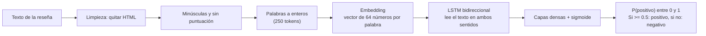

# 🎬 Análisis de sentimiento de reseñas con una RNN (LSTM) + Streamlit

Proyecto de Deep Learning con **datos secuenciales (texto)**: una **red recurrente LSTM bidireccional**, entrenada con TensorFlow/Keras, que clasifica reseñas de películas como **positivas** o **negativas**. Incluye una **aplicación Streamlit** que carga el modelo entrenado, permite escribir una reseña nueva y muestra el sentimiento predicho junto con su nivel de confianza.  

## app capturas en local 


## 1. Dataset
**IMDB Large Movie Review Dataset** (Maas et al., 2011), descargado automáticamente desde `https://ai.stanford.edu/~amaas/data/sentiment/aclImdb_v1.tar.gz` (no se incluye en el repositorio; `data/` está en `.gitignore`).

- 50.000 reseñas de películas **en inglés**: 25.000 de entrenamiento y 25.000 de prueba (partición oficial), con clases balanceadas.
- Etiqueta binaria a partir de la calificación del usuario: **negativa** (≤ 4 de 10) o **positiva** (≥ 7 de 10). Las reseñas neutras no están incluidas.
- La carpeta `train/unsup` (reseñas sin etiqueta) se ignora.

## 2. Estructura del repositorio
```
.
├── notebooks_colab/
│   └── 01_rnn_sentimiento_experimentacion.ipynb   # Experimentación completa (Google Colab)
├── src/
│   ├── config.py       # Hiperparámetros y rutas
│   ├── text_utils.py   # Limpieza de texto
│   ├── data.py         # Descarga, lectura y partición train/val/test
│   ├── model.py        # Arquitectura LSTM bidireccional
│   ├── train.py        # Entrenamiento y guardado del modelo
│   ├── evaluate.py     # Evaluación en test (métricas y figuras)
│   ├── predict.py      # Predicción de un texto (CLI y reutilizado por Streamlit)
│   └── plots.py        # Gráficas
├── app/
│   └── streamlit_app.py                           # Aplicación web
├── models/
│   └── sentiment_rnn.keras                        # Modelo entrenado (incluye el vectorizador)
├── reports/
│   ├── metrics.json  history.json  RESULTADOS.md  predicciones_12.csv
│   └── figures/                                   # Gráficas generadas
├── requirements.txt
└── README.md
```

## 3. Metodología
1. **Análisis exploratorio:** balance de clases, longitud de las reseñas, duplicados y solapamiento train/test, ruido HTML, palabras más frecuentes por clase y ejemplos.
2. **Limpieza:** eliminación de etiquetas HTML (`<br />`) y normalización de espacios.
3. **Preprocesamiento:** minúsculas y eliminación de puntuación, tokenización con vocabulario de 20.000 palabras y secuencias de 250 tokens (padding/truncado). Todo esto vive **dentro del modelo** (`TextVectorization`), por lo que la app recibe texto crudo y aplica exactamente el mismo preprocesamiento del entrenamiento.
4. **División:** conjunto de **prueba oficial** (25.000 reseñas) + 80 % / 20 % estratificado del train oficial para entrenamiento y validación. El vocabulario se aprende solo con el entrenamiento (sin fuga de datos).
5. **Modelo:** `Embedding(20000→64) → Bidirectional(LSTM(64)) → Dropout → Dense(32) → Dropout → Dense(1, sigmoide)`.
6. **Entrenamiento:** Adam, `binary_crossentropy`, EarlyStopping (restaura los mejores pesos) y ReduceLROnPlateau.
7. **Evaluación:** accuracy, precisión, recall, F1, AUC-ROC, matriz de confusión y curva ROC sobre el conjunto de prueba.
8. **Línea base:** comparación con TF-IDF + regresión logística, como referencia.
9. **Predicciones:** 12 reseñas de prueba y análisis de errores.

### 3.1 Exploración del dataset

| Balance de clases | Longitud de las reseñas |
|---|---|
|  |  |


### 3.2 ¿Cómo decide el modelo si una reseña es positiva o negativa?



1. **Preparación:** se limpia el texto y se convierte en una secuencia de 250 números enteros (uno por palabra; las palabras desconocidas se marcan como `[UNK]`).
2. **Embedding:** cada palabra pasa a ser un vector de 64 números que la red aprende durante el entrenamiento; palabras con significado parecido tienden a quedar cerca.
3. **LSTM bidireccional:** la red recurrente lee la reseña palabra por palabra, **de izquierda a derecha y de derecha a izquierda**. Sus compuertas deciden qué información conservar u olvidar, así puede relacionar palabras lejanas ("la película no fue buena" ≠ "la película fue buena").
4. **Salida:** una neurona sigmoide entrega la probabilidad de que la reseña sea **positiva**. Si es ≥ 0,5 se predice positiva; la **confianza** que muestra la app es la probabilidad de la clase predicha. Por ejemplo, P(positivo) = 0,12 significa "negativa con 88 % de confianza".

## 4. Resultados
Resultados reales sobre el **conjunto de prueba oficial** (25.000 reseñas que el modelo nunca vio). Fuente: `reports/metrics.json`.

| Métrica | Valor |
|---|---|
| Accuracy | **85,06 %** |
| Precisión (positiva) | 88,30 % |
| Recall (positiva) | 80,83 % |
| F1 (positiva) | **84,40 %** |
| F1 macro | 85,03 % |
| AUC-ROC | 0,9328 |
| Pérdida (loss) | 0,344 |

| Clase | Precisión | Recall | F1 | Reseñas |
|---|---|---|---|---|
| negativo | 82,3 % | 89,3 % | 85,7 % | 12.500 |
| positivo | 88,3 % | 80,8 % | 84,4 % | 12.500 |

Matriz de confusión: 11.161 negativas bien clasificadas, 1.339 negativas predichas como positivas, 2.396 positivas predichas como negativas y 10.104 positivas bien clasificadas (3.735 errores en total, 14,9 %).

**Lectura de los resultados**
- **Sobreajuste rápido:** el entrenamiento se detuvo en la época 5 y se restauraron los pesos de la **época 2** (entrenamiento 91,60 % vs validación 86,42 %). En las épocas siguientes el accuracy de entrenamiento llega a ≈99 % mientras el de validación se queda en ≈87 % y la pérdida de validación sube. El *early stopping* controla el problema, pero no lo elimina.
- **Sesgo hacia la clase negativa:** el recall es 89,3 % en negativas y 80,8 % en positivas; hay más positivas clasificadas como negativas (2.396) que al revés (1.339).
- **Comparación con una línea base clásica:** TF-IDF + regresión logística obtuvo **mejor** resultado que la LSTM en este experimento.

| Comparación en test | LSTM bidireccional | TF-IDF + Reg. logística |
|---|---|---|
| Accuracy | 85,06 % | 89,73 % |
| F1 (positiva) | 84,40 % | 89,78 % |
| AUC-ROC | 0,9328 | 0,9611 |

  Es un resultado conocido en IMDB (reseñas largas donde los n-gramas TF-IDF capturan bien el sentimiento). No se probaron otras configuraciones de la LSTM, por lo que no se afirma la causa.
- **Errores de mayor confianza:** en los ejemplos revisados aparecen reseñas con tono irónico o con etiquetas discutibles; no se validó esto sobre todos los errores.
- **Dato a tener en cuenta:** el análisis exploratorio encontró 123 textos idénticos presentes en train y test (0,5 % del test); no se eliminaron.
- Versiones: Python 3.13.15, TensorFlow 2.21.0, Keras 3.13.2.

### 4.1 Curvas de entrenamiento


### 4.2 Matriz de confusión y curva ROC (conjunto de prueba)
| Matriz de confusión | Curva ROC |
|---|---|
|  |  |

### 4.3 Predicciones de prueba (12 reseñas)


Barra verde = acierto, roja = error. En esta muestra hay 10 aciertos y 2 errores. Detalle en `reports/predicciones_12.csv`. Es una muestra ilustrativa; el desempeño real es el de las métricas sobre las 25.000 reseñas de prueba.

### 4.4 Pruebas de la aplicación Streamlit
<!-- Capturas de la app con reseñas nuevas (positiva, negativa, ambigua y en español) -->

## 5. Cómo ejecutarlo

### Requisitos
- **Python 3.11 a 3.13** (probado con 3.12 y 3.13). **No usar Python 3.10 ni anterior**: Keras 3.13.2, con el que se guarda el modelo, requiere Python 3.11 o superior.
- Entrenado en Google Colab con TensorFlow 2.21.0 y Keras 3.13.2 (versiones fijadas en `requirements.txt`).

```bash
git clone https://github.com/<USUARIO>/<REPOSITORIO>.git
cd <REPOSITORIO>
```

**Windows**
```bash
py -3.13 -m venv .venv
.venv\Scripts\activate
pip install -r requirements.txt
```

**Mac / Linux**
```bash
python3 -m venv .venv
source .venv/bin/activate
pip install -r requirements.txt
```

### A) Solo usar la aplicación (el modelo ya está en `models/`)
```bash
streamlit run app/streamlit_app.py
```
Se abre en `http://localhost:8501`. Escribe una reseña **en inglés** (o usa los botones de ejemplo) y pulsa *Analizar sentimiento*: verás el sentimiento, la confianza y la probabilidad de cada clase.

### B) Reproducir el entrenamiento en Google Colab
1. Abre el notebook de `notebooks_colab/` en Colab (*Archivo → Subir cuaderno*, o desde la pestaña *GitHub*).
2. *Entorno de ejecución → Cambiar tipo de entorno → GPU*.
3. *Ejecutar todo*. Al final se descarga `resultados_colab.zip` con `models/` y `reports/`.

### C) Reproducir el entrenamiento desde la terminal
```bash
python -m src.train          # descarga el dataset, entrena y guarda models/sentiment_rnn.keras
python -m src.evaluate       # métricas y figuras sobre el conjunto de prueba
python -m src.predict "This movie was absolutely wonderful"
```
Parámetros opcionales: `--epochs N`, `--data-dir RUTA/aclImdb`.

## 6. Limitaciones
- El modelo solo entiende **inglés** y el dominio de **reseñas de películas**. Con otro idioma u otro tipo de texto la predicción no es fiable; la app avisa cuando una gran parte de las palabras no está en el vocabulario.
- Las secuencias se truncan a 250 tokens, por lo que en reseñas muy largas se pierde información del final.
- La probabilidad no es una medida perfecta de certeza: puede haber confianza alta en errores (ironía, sarcasmo, reseñas con opiniones mezcladas).
- Mejoras posibles: embeddings preentrenados (GloVe), modelos Transformer preentrenados, búsqueda de hiperparámetros y calibración de probabilidades.
